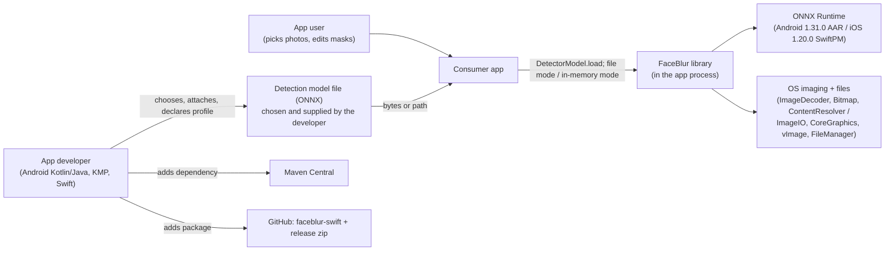
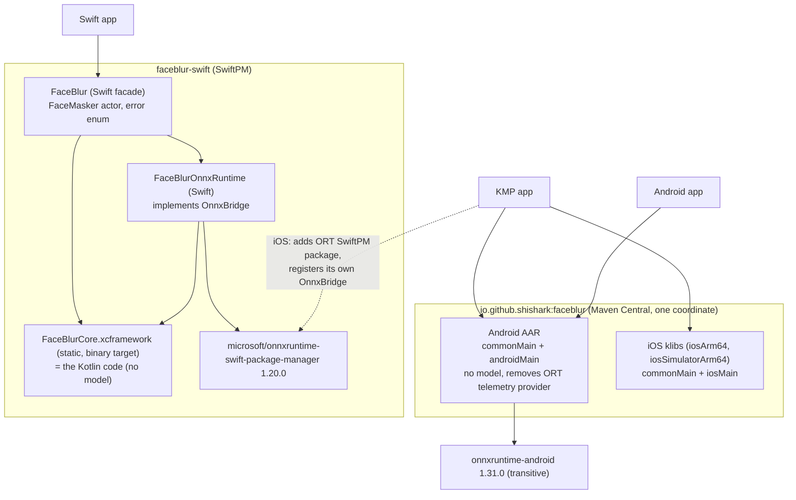
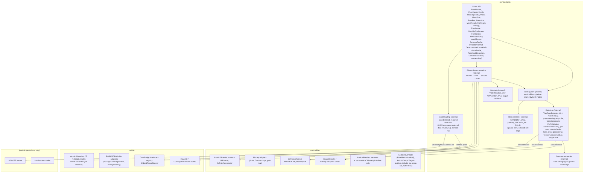

# FaceBlur architecture

Status: current for 0.1.0; history: first draft 2026-11-01, revised 2026-11-01 after review and again at the start of milestone 1
(accepted ADRs 0005 and 0006, only privacy-reliable options in ADR 0002), and after the owner approved the settings
table (detection floor with a separate smaller output, `GRADIENT_OVAL` default with the opacity invariant, pixel
limit that never lowers detection, fail-closed errors). Decisions referenced here are in
`docs/adr/` (0001-0015; each ADR states its own status). Revised 2026-11-02 for the developer-supplied model
(ADR 0012, accepted): FaceBlur ships no model. Revised again 2026-11-02 for the bounded mask stage (ADR 0013,
accepted): mask limits, a linear mask stage that writes only in a final copy, and a working area reserved before
the first write; amended the same day: Android and the JVM check the remaining heap before that reservation.
Revised 2026-11-03: final technical limits (generous; exceeding one fails safely), the in-pass NMS work bound, the
actionable `TOO_MANY_MASKS` message, and the documentation rule "off the main thread, with cancellation"; later the
same day: the in-pass NMS work bound final with an actionable message, and the evaluation tool's formats and metrics
(ADR 0014); later the same day: on Android only ONNX Runtime's telemetry provider is removed, the permissions stay
with the app (ADR 0007, revised), and the Android binding needs no setup call (ADR 0015, proposed).
Implementation is in progress: where code and this document differ, the ADRs decide. Statements about behaviour are
the design, not measurements.

FaceBlur runs a face-detection model that the app developer supplies (ONNX, through ONNX Runtime) on still photos on
the device, covers the detected faces with opaque masks, and (in file mode) re-encodes the photo from pixels without
the source's metadata or auxiliary images. It ships no model: the developer chooses the model, describes it with a
profile and is responsible for it, its licence, its training data and its score threshold (ADR 0012). It is a data
minimisation tool: detection can miss faces, and a masked photo still shows bodies, clothing and context.

## 1. Context



Design goal: no network access at runtime and no telemetry. The library itself opens no sockets; on Android, ONNX
Runtime's telemetry provider is removed from consumer apps and telemetry is disabled at runtime (ADR 0007); the
`INTERNET` and `ACCESS_NETWORK_STATE` permissions that ONNX Runtime declares are not removed by the library (an app
that wants none removes them in its own manifest, recipe in the integration guide); the no-traffic test on both
platforms checks that no traffic occurs in the tested configuration (on Android an app that has `INTERNET`, with a
positive control). Builds fetch pinned, checksum-verified
binaries: ONNX Runtime for SwiftPM and, for tests only, the internal reference model (ADR 0009); that is build time
only. No published artifact contains a model.

## 2. Containers (what ships where)



- One published Gradle module (`:faceblur`); the `jvm` target is built and tested but not published (ADR 0002).
- KMP apps use the Maven artifact only, never the Swift package as well.
- Demo apps (not published): `samples/android` (Kotlin + Java example), `samples/kmp` (Compose Multiplatform,
  Android and iOS), `faceblur-swift/Examples/SwiftUIDemo`. A separate `verification/` build consumes only the
  published artifacts (ADR 0001).

## 3. Components



Package layout: public API in `io.github.shishark.faceblur`; everything else in `io.github.shishark.faceblur.internal.*`
with `internal` visibility (explicit API mode; the ABI dump shows any leak). Platform fast paths (Canvas/vImage crops)
are internal subtypes the core recognises; a custom `PixelImage` uses the common resampler.

## 4. Data flows

### 4.0 Loading the model and creating instances

```mermaid
sequenceDiagram
    participant A as App (worker thread)
    participant L as DetectorModel.load
    participant F as FaceMasker(model, config)
    participant R as Runtime (ORT session)
    A->>L: ModelSource.fromFile(path) or fromBytes(bytes), DetectorProfile, maxModelBytes
    L->>L: profile already validated (InvalidConfiguration otherwise)
    L->>L: read once into a library buffer: regular file, ≤ maxModelBytes (default 50 MiB)
    L->>L: SHA-256 must equal the required expectedSha256 (ModelIntegrity), before any parsing
    L->>L: bounded ONNX pre-parse: refuse ORT format, external data anywhere, ambiguous encodings; read graph IO (ModelRejected)
    L-->>A: DetectorModel (deeply immutable, thread-safe; info = SHA-256, size, IO, non-blocking warnings)
    A->>F: one instance per worker
    F->>R: session from the verified bytes (Android/JVM: duplicate of one direct ByteBuffer; iOS: carrier file, ADR 0010), locked options incl. ONNX format
    F->>R: runtime IO equals the pre-parse (iOS: names)
    F->>R: contract run on a mid-grey input: types, shapes, finite values, probabilities
    F-->>A: FaceMasker (or ModelRejected / RuntimeUnavailable)
```

The library does not judge the model: there is no operator allow-list, and an operator the runtime does not have
fails at session creation. A well-formed model with a wrongly declared profile can find no faces and still report
success; `checkProfile`, the demos' check step and the evaluation tool exist to check a setup (ADR 0012; the
evaluation tool's ground-truth format, profile file and metric definitions: ADR 0014).

### 4.1 Shared core (both modes)

```mermaid
sequenceDiagram
    participant C as Caller (mode entry)
    participant K as Masking core
    participant T as TiledFaceDetector
    participant Y as Format decoder (YuNetLayout / GenericDetections)
    participant R as TensorRunner (platform)
    participant M as Mask renderer
    C->>K: maskInPlace(image) / detect(image) / applyMasks(image, plan)
    K->>K: checks: main thread? concurrent use? closed? supported image?
    K->>T: detect(image)
    loop global pass (≤ model input) + tiles of the model input size, 25 % overlap per axis
        T->>T: cancellation check
        T->>Y: crop + scale (platform fast path or common resampler), letterbox top-left
        Y->>R: run(input tensor per profile: colour order, layout, scaling; reused buffer)
        R-->>Y: output tensors
        Y->>Y: output checks (counts, finite, probabilities, caps) else ModelOutputInvalid
        Y-->>T: boxes in tile coordinates (decode + NMS 0.3 unless NMS is in the model graph)
    end
    T-->>K: merged boxes (spatially indexed cross-pass merge: IoU 0.4, containment 0.7; per-photo candidate and work bounds), clipped to the image
    K->>K: masks = Mask.fromFace(box) + part masks of merged faces, or one RECTANGLE cover for a face that grew more than 32 times (expand max(profile minimum, MaskingConfig), at least 1.6 × 1.8; shift up 0.08)
    K->>K: mask limits (count, summed working area) else TOO_MANY_MASKS or InvalidConfiguration for masks
    K->>M: step 1, check and reserve: validate masks, compute the working-area size, check it against available memory and the reserved count, allocate all of it (else NotEnoughMemory)
    M->>M: step 2, compute: coverage map, each fill from original pixels, composite into the shadow tiles (cancellation read throughout)
    K->>K: last cancellation check before the copy
    K->>K: Android 14+: remove gain map (always, also with zero faces)
    M->>M: step 3, copy: write the marked pixels of the shadow tiles into the image, read back and compare
    K->>K: cancellation requested during the copy? → throw Cancelled (image fully masked)
    K-->>C: MaskResult(faces, masks, timings, gainMapRemoved)
```

Cancellation is checked before detection, between detector passes, and during the mask computation (between masks
and at least every 65,536 units of work). The mask stage writes the image only in its final copy, which is not
interrupted: the call copies all masks and only then reports a cancellation that was requested meanwhile, so an
in-memory image is either untouched or fully masked, never half-masked (ADR 0002 decision 8, ADR 0013 decision 4).
Every other failure before the copy, including a working area that cannot be reserved, leaves the image untouched;
only `MaskWriteFailed` (the caller's image failed during the copy) can leave it partly written. The stage has no
step over pairs of masks: its time and memory grow with the number of masks and their summed area, not with how
they overlap (ADR 0013 decision 3). Both modes call exactly this function, which is why the same pixels give the
same boxes and masks.

### 4.2 Android, file mode

```mermaid
sequenceDiagram
    participant A as App (worker thread)
    participant F as FaceMasker.maskFile
    participant D as ImageDecoder
    participant K as Masking core
    participant E as Bitmap.compress + EXIF writer + validator
    participant W as Writer
    A->>F: maskFile(context, sourceUri, target, options[, plan])
    opt KeepAllowlist
        F->>F: read allowlisted EXIF via ExifInterface → PhotoMetadata
    end
    F->>D: header check (each working side ≤ 65,535 px and pixel limit on the working size, else ImageTooLarge), then decode once: orientation applied,<br/>setTargetSize(working size: maxLongSide, never below 3,500 px unless the source is smaller), software, mutable, sRGB
    D-->>F: ARGB_8888 Bitmap; gain map cleared (API 34+)
    F->>K: maskInPlace(bitmap) or applyMasks(bitmap, plan) on the working image
    opt maxOutputLongSide smaller than the working size
        F->>F: scale the MASKED bitmap down to the output size; release the working bitmap
    end
    F->>F: cancellation check
    F->>E: clear gain map again; compress JPEG q90 to memory; rebuild segments (SOI, library fixed JFIF APP0 without thumbnail, library APP1 with<br/>Orientation=1 [+ allowlist], image data; every encoder APPn incl. ICC dropped); validate
    F->>F: cancellation check (last one; nothing written yet)
    alt file path
        F->>W: temp file (masked output only) in target dir → fsync → atomic rename
    else content URI
        F->>W: probe with "r": readable regular file? else UnsupportedTarget (nothing written)
        F->>W: non-empty target without overwriteNonAtomic? UnsupportedTarget (nothing written)
        F->>W: "wt" → write → ftruncate → fsync → fstat size check → close (error = failure) → full byte comparison via a new "r" descriptor
        F->>W: on failure while writing: ftruncate(0), close, report the original error
    end
    F-->>A: FileResult (faces, output size, timings)
```

### 4.3 Android, in-memory mode

The app decodes (software allocator, mutable), bakes the orientation and scales; then `maskInPlace(bitmap)` checks
mutable/ARGB_8888/not recycled (else `UnsupportedImage`, nothing changed), runs detection, and after the last
cancellation check removes the gain map on API 34+ and writes the masks, then returns. The app draws its watermark
into the same bitmap, encodes once and adds its own metadata. The bitmap is never copied; the call adds tile buffers
and the mask stage's working area, which is reserved in full before the first pixel is written (ADR 0003 decision
5, ADR 0013 decision 6).

### 4.4 iOS, file mode

Same steps as 4.2 with: ImageIO thumbnail decode (orientation transform + max pixel size) into a decoded `CGImage`
that is drawn once into a library-owned RGBA buffer and then released (two full-size buffers exist briefly, see
section 6), preceded by the per-side and pixel-limit checks from the header and a free-memory headroom check sized for that peak; the
core runs on that buffer wrapped like a caller buffer;
`CGImageDestination` encodes from a no-copy view with only the quality property (no auxiliary images); segment
rebuild (fixed JFIF APP0 + library APP1; every encoder APPn, including any ICC profile, dropped) + validation; temp file + `rename`, or the item-replacement directory + `replaceItemAt` (ADR 0005); `GC.collect()` after
the call.

### 4.5 iOS, in-memory mode

The Swift app draws the decoded, oriented, scaled image into its own `CGContext` (or holds a `CVPixelBuffer` /
vImage buffer). The facade (`FaceMasker` actor on its private serial queue) extracts address, size, stride and layout,
calls Kotlin with primitives only, Kotlin wraps the memory as `MutablePixelImage` and runs the core; detection crops are
no-copy `CGImage` views or vImage-scaled tile buffers; ONNX Runtime runs in Swift behind `OnnxBridge`. The app then draws
its watermark into the same context and encodes from pixels without copying auxiliary data from the source (ADR 0004).

### 4.6 KMP common code

`commonMain` of an app loads `DetectorModel.load(ModelSource.fromFile(path), profile)` once and creates
`FaceMasker(model, config)` per worker (the model arrives as bytes or a path, ADR 0012), calls
`masker.suspending().maskFile(path, target, options)` for files, or `maskInPlace(pixels)` on a `MutablePixelImage`
obtained from its own platform code (`bitmap` adapter on Android, `CGContextRef.asMutablePixelImage()` or `wrapRgba` on
iOS). Decoding, watermarking and encoding for the in-memory pipeline stay `expect/actual` in the app; the KMP demo
shows this.

## 5. Threading model

- Every public `FaceMasker` method blocks. On Android and iOS a call from the main thread throws
  `FaceMaskException.MainThread`.
- One call at a time per instance; for parallel work, one instance per worker. Concurrent entry is detected and
  throws `ConcurrentUse`. The detector reuses its input tensor buffer and is not reentrant.
- `DetectorModel` is immutable and thread-safe; any number of instances may be created from it, also in parallel.
  `DetectorModel.load` and `FaceMasker` creation block and belong off the main thread (KDoc; not rejected).
- Documentation rule (ADR 0002 decision 8): every masking example and demo runs the call off the main thread and
  offers cancellation, because a call within every technical limit can still take long on a phone.
- Inside one call: ONNX Runtime with the XNNPACK execution provider owning min(4, cores) worker threads, ONNX Runtime
  intra-op pool 1, spinning off (Android and iOS identical; CPU EP fallback). JVM: CPU EP, tests only.
- Wrappers: the Kotlin coroutine wrapper and the Java `CompletableFuture` wrapper are deferred to 0.2 (ADR 0002
  decision 8); in 0.1.0 apps call the blocking API from a background dispatcher or executor and cancel through a
  `CancellationToken`, as the guides show. Swift `FaceMasker` actor on a private
  `DispatchSerialQueue` executor (surfaces `CancellationError`), plus `FaceMaskerSync`. The blocking API surfaces
  `FaceMaskException.Cancelled`.
- Several instances may run in parallel, each with its own session and XNNPACK pool; on a phone with four fast cores
  this is not expected to be faster (ESTIMATE; performance-engineer measures).
- The ONNX Runtime environment is process-wide and never closed; sessions are closed with the instance.

## 6. Memory rules

Common
- No copy of the caller's image inside any call; detection works on a global pass no larger than the model input and
  one tile of the model input size at a time.
- Mask stage (ADR 0013 decision 6): it computes the size of its whole working area (shadow tiles for the exact
  union of the tiles the write rectangles touch, each tile once, write marks, a coverage map for the tiles of the
  opaque rectangles, per-mask arrays, the fill scratch of the largest mask) and allocates all of it
  before the first write, then touches every page of it once. Fills read the original pixels from the caller's image
  in runs of at most 64 pixels (one reserved array per run length, so every array passed to the image has exactly
  `w × h` elements) and compute their values per shadow tile, so no buffer of a mask's whole area exists. The copy
  step and FaceBlur's own adapters allocate nothing. A photo with a few faces needs a few megabytes; the worst case
  (masks over almost the whole image) is 4.3 bytes per image pixel plus 32 MiB, about 141 MB at 25 MP, about one copy
  of the pixels plus a fixed part. The fixed part is sized per call from the plan, not reserved in full on every
  call, and the working area is held per call (step 1 to the end of the copy), not per instance: N calls running in
  parallel need up to N times it. The KDoc of the in-place calls states the worst case and the
  recommended number of parallel masking calls on phones (at most 2; for stream-form sources near the 64 MiB cap,
  one call at a time, ADR 0015 decision 4). The guides give the worst-case
  rule but state no masking times; slower phones take longer, so callers run masking off the main thread and
  offer cancellation. Before allocating,
  every platform checks that the working area fits in the memory available now, minus a process-wide count of the
  bytes reserved by other running calls, so that parallel calls do not share the same free memory; if it does not
  fit, the call throws `NotEnoughMemory` without allocating and the image is untouched. On Android and the JVM the
  available memory is the remaining heap (`Runtime.maxMemory()` minus the heap in use, after one garbage collection
  if it does not fit at first), because an `OutOfMemoryError` on Android can hit any thread of the app; an
  `OutOfMemoryError` inside the allocation function is still caught, only as a last-resort backstop. On iOS a failed
  allocation cannot be relied on to give a catchable error: the system usually ends an app whose memory footprint
  crosses its limit before any allocation fails, so the check uses the memory the system reports as available (a
  figure of 0 is refused on a device and skipped only on the simulator). A buffer shared with another process can
  keep a partly written image if the system ends the app during the copy; the DocC advises process-private buffers.
- The input tensor (4.9 MB for a 640 × 640 input) and the output buffers are allocated once per instance.
- The model bytes are held once by `DetectorModel` (default cap 50 MiB, adjustable; on Android/JVM in one direct
  buffer that each creation reads through its own duplicate). Creating an instance needs about
  3-4 × the model size for a short time (ESTIMATE), about 1-2 × afterwards.

Android
- In-memory: the caller's bitmap is never copied; unsupported bitmaps are rejected (ADR 0003). The call adds the
  tile buffers and the mask stage's working area (above).
- File mode: one bitmap at output size (reduced-size decode), plus the compressed JPEG in memory before writing.

iOS (rules carried over from the benchmark app, all mandatory)
- One full-resolution buffer per photo while masking and encoding; detection images, tile crops that need no
  resampling and the encoder input are no-copy `CGImage` views of it; only downscaled crops get their own small
  buffer. In file mode the decode step holds two full-size buffers for a short time (the decoded `CGImage` and the
  library's RGBA buffer it is drawn into); the decoded image is released before detection starts, and the headroom
  check budgets for this transient peak of two buffers.
- In-memory mode: the caller's buffer is never copied; the call adds tile-sized buffers and the mask stage's working
  area, checked against the available memory before it is allocated (above, ADR 0004 decision 4).
- Never `CGBitmapContextCreateImage`.
- No per-call Objective-C objects created in or returned to Kotlin; pixels cross the bridge as address + size + stride;
  CoreFoundation objects are created and released explicitly; `autoreleasepool` around bridge calls.
- `GC.collect()` after each completed public call (the library's "between photos"). Its duration is reported as
  `Timings.gcMs` and is not part of `Timings.totalMs`; performance measurements time each photo with the wall clock
  (KDoc says so).
- vImage Lanczos for tile scaling.
- File mode checks free memory before decoding (the benchmark app's headroom check).
- ONNX Runtime bridge (ADR 0010): only primitives cross per pass; input and output tensors live in native buffers
  that the library allocates once per `FaceMasker`, and the Swift glue copies outputs into them; Kotlin checks the
  type, shape and bytes written per output (sentinel and NaN prefill) and runs the contract run when a session opens. The benchmark's
  per-pass `NSData` dictionaries are not used. Swift apps get the glue automatically; KMP apps register it once at
  start-up; the runtime version 1.20.0 is checked at run time.

## 7. Error model

`FaceMaskException` (sealed, unchecked, declared with `@Throws` on every public function) in Kotlin/Java;
`FaceMaskError` (enum) in Swift; one-to-one mapping. On iOS every public entry point converts any other throwable into
`FaceMaskException.Internal`, so nothing undeclared crosses into Swift. On Android and the JVM, `VirtualMachineError`
(including `OutOfMemoryError`) is rethrown unchanged, never wrapped, with one exception: an `OutOfMemoryError` inside
the mask stage's working-area allocation becomes `NotEnoughMemory`, before any pixel is written (ADR 0013 decision
6); it is only a backstop behind the remaining-heap check. `ImageTooLarge` comes only from the size checks;
`NotEnoughMemory` comes from the iOS file-mode headroom check and from the working-area reservation (the check before
the allocation on every platform, and that one catch). Elsewhere
out-of-memory is avoided by the size caps, not caught. After an in-memory call ends with an error that is not a
`FaceMaskException`, the image must be discarded; `NotEnoughMemory` means the image was not masked and must not be
published or uploaded as if it were.
Invalid configuration values throw `InvalidConfiguration(parameter)` from the configuration types' constructors and
builders (declared with `@Throws`); the Swift facade validates the same ranges in Swift first, so a bad value never
crashes a Swift app and always names the parameter.
Model errors: `ModelIntegrity` (the model's SHA-256 differs from the required `expectedSha256`),
`ModelRejected(findings)` (file or model refused at load or creation), `ModelOutputInvalid(findings)` (a pass's output
failed the checks); `Internal` is for library faults only (ADR 0012).
Fail closed: invalid caller boxes or masks throw `InvalidConfiguration`; non-finite or out-of-range model output, a
box whose edges are not strictly ordered before clipping (zero size included) and a box beyond the technical bounds
relative to the tile throw `ModelOutputInvalid` before any pixel is written (within the bounds, a box partly outside
the image is normal and is clipped and masked; only a box that becomes empty by clipping is dropped), in-memory images above 2³¹ − 1 pixels throw `ImageTooLarge` before any call
into the caller's image, and dropped writes to a caller's `MutablePixelImage` throw `MaskWriteFailed`; FaceBlur never returns
an image with a detected or requested face silently unmasked or partly masked. Plans above the mask limits (65,536
masks, summed working area 32 × the image, both final) throw `InvalidConfiguration("masks")` for a caller's
plan and `ModelOutputInvalid` with `TOO_MANY_MASKS` for masks from the model, before the mask stage reads any pixel;
the `TOO_MANY_MASKS` message names the mask count and the score threshold and says that the threshold is very likely
too low for this model (check it with faceblur-eval). The in-pass NMS and the cross-pass merge have per-photo work
bounds (`TOO_MANY_NMS_PAIR_CHECKS` at 240,000,000 pair checks, final, with a message in the same actionable style:
pair checks reached, score threshold, limit, faceblur-eval advice; `TOO_MANY_MERGE_CANDIDATES`), checked before any
pixel is written. All limits are
generous technical limits; exceeding one fails safely (ADR 0012 decision 6).
If an in-memory call throws, the image is untouched, except after `MaskWriteFailed` (discard it) and after
`Cancelled` requested during the final copy (fully masked) (ADR 0013 decision 4).
Messages never contain pixels, file names, paths or face coordinates; the library never logs at INFO or above with
such data and has no crash-report hooks. File mode is designed so that a failed call leaves no partial output and an
unchanged target for file-system paths (tested by fault injection); content-URI overwrite needs the explicit opt-in
`AndroidOutputTargets.overwriteNonAtomic`, is verified by a full read-back comparison but is not atomic (after any
error the target must be treated as unmasked), and targets the library cannot read back are refused before writing
(ADR 0005). Details: ADR 0002 decision 9.

## 8. Model source, checks and limits

FaceBlur ships no model (ADR 0012, which supersedes ADR 0006). The app passes the model as bytes or a
file path. The library reads it once into its own buffer (regular file, size cap 50 MiB by default, adjustable),
computes its SHA-256, compares it with the profile's required `expectedSha256` before any parsing (fixed order: size
cap, hash, pre-parse, runtime; a file that does not match is never parsed), and pre-parses the ONNX file with a
bounded walk (description limits including at most 65,536 main-graph inputs, so its time grows about linearly with
the file size; loading cannot be cancelled) that refuses the ORT format identifier, external-data references anywhere in the model and
ambiguous protobuf encodings, and the session options lock the ONNX format. The runtime only ever receives these
verified bytes: Android/JVM create the session from a direct `ByteBuffer`; on iOS, ONNX Runtime 1.20.0 loads only from
a path, so Kotlin writes the bytes to a per-creation carrier file, re-hashes it, passes its path and unlinks it as
soon as the session is open (ADR 0010 decision 6). The app's own path never reaches the runtime. Creation checks the
runtime's view of the inputs and outputs and runs one contract pass; every later pass checks the output before any
pixel is written. There is no operator allow-list and no model-quality check: the developer is responsible for the
model, its profile and its threshold. The guide recommends bundling the model in the app with its hash in the app's
code; over-the-air updates are the app's own code and need a manifest signed by the developer (ADR 0012 decision 10).
The hash is only as trustworthy as its source, so the pre-parse keeps all its limits. Tests use a model in the YuNet layout as an
internal reference fixture, pinned by the build, never published (ADR 0009).

## 9. Configuration and defaults

Only privacy-reliable options exist (product principle): opaque styles only, no tuning of the library's own detection
rules (tiling, merge, NMS, mask shift), and every
exposed setting limited to a range that cannot lower protection, apart from three approved opt-ins (off by default,
risk documented): caller-edited mask lists, the metadata allowlist, the non-atomic content-URI overwrite. The model,
its profile and its score threshold are the developer's responsibility and are validated only technically (ADR 0012;
a lower threshold never removes or shrinks a mask). The full
list with the approved ranges is ADR 0002 decision 10, together with the mask opacity invariant. Detection runs on
at least 3,500 px (or the source size); a smaller output is produced only by scaling the masked image afterwards.
In-memory callers follow the same rule: scale to no less than 3,500 px before FaceBlur, further only after it.

| Setting | Default | Where |
|---|---|---|
| Model | none; required, supplied by the app (bytes or path); size cap 50 MiB by default, adjustable | `DetectorModel.load(source, profile, maxModelBytes)` |
| Model profile | required: format, input width/height (128-1,280 px), score threshold (any value in (0, 1)), expected SHA-256 of the model file (required), minimum mask expansion (at least 1.6 / 1.8); a small input can miss mid-size faces, so below a smaller input side of 384 px at 3,500 px (growing with the working size) the non-blocking `SMALL_INPUT` warning is reported in `ModelInfo` and in each result | `DetectorProfile` (the developer's responsibility) |
| Tile side / overlap / tile everything above | model input size / 0.25 per axis / 0 px (always tile) | internal (not exposed) |
| Global pass | ≤ model input | internal |
| Cross-pass NMS / in-pass NMS / containment merge | 0.4 / 0.3 (skipped only for NMS inside the model graph) / 0.7; caps raise an error, never truncate | internal (not exposed) |
| Mask | ellipse, ×1.6 width, ×1.8 height (or the profile's larger minimum), outward feather 0.10 | `MaskingConfig` (shape, expandX/Y, feather) |
| Mask centre shift | up 0.08 × box height | internal (not exposed) |
| Mask style | `GRADIENT_OVAL` (also `SMOOTH_FILL`, `SOLID`); opaque core = exactly the measured ellipse, alpha 255 inside, soft edge blended outward (colour and alpha); no blur, pixelation or other non-opaque style, ever | `MaskingConfig.style` |
| Fill colour (SOLID, GRADIENT_OVAL centre) | 0xFF7F7F7F (opaque only) | `MaskingConfig.color` |
| ONNX threads | 0 = automatic (XNNPACK pool min(4, cores)); 0-4 | `FaceMaskerConfig.onnxThreads` |
| Working size for detection and masking (file mode) | 3,500 px; 0 = source size; never below 3,500 | `FileOptions.maxLongSide` |
| Smaller output (file mode, scaled after masking) | 0 = working size; 64 px or more, never upscales | `FileOptions.maxOutputLongSide` |
| Coordinates of results and mask plans (file mode) | working-image pixels; output size reported separately | ADR 0002 decision 4 |
| Pixel limit on the working image (file mode, checked from the header) | 25 MP (13-100 MP); above it `ImageTooLarge`, never a smaller detection; source ceiling 200 MP (fixed) | `FileOptions.maxDecodedPixels` |
| Input formats | JPEG, HEIC, PNG (identified from the first bytes) | ADR 0005 decision 7 |
| Output | JPEG quality 90 (JPEG only) | `FileOptions.format` |
| Overwrite of an existing Android content URI | only with the explicit opt-in | `AndroidOutputTargets.overwriteNonAtomic` |
| Metadata | strip all; Orientation written as 1; no ICC profile in 0.1.0 (sRGB by convention); fixed JFIF APP0 without thumbnail | `FileOptions.metadata` |
| Allowlist flags (opt-in) | `gps`, `dateTime`, `camera` all `false` | `MetadataPolicy.KeepAllowlist` |
| Output target | none, must be chosen | `OutputTarget` |

Note for the accuracy regression: it runs internally with the reference model and the documented YuNet example
profile. The benchmark detected on full-resolution photos; comparisons with it use `maxLongSide = 0`. The 3,500 px
default is measured separately.

## 10. Quality gates tied to this design

| Concern | Gate |
|---|---|
| Decoder/runtime parity | reference test tiers 1, 1b, 2, 3 and the generic-format tier G, with the internal reference fixture (ADR 0009) |
| Extraction fidelity | library vs benchmark app with the reference model on the same photos and device, within ±0.5 percentage points (comparisons run with `maxLongSide = 0`, see section 9); no public claim about detection quality |
| Speed | time per detector pass ≤ 1.10 × the benchmark app on the same device; time per photo at 2,200 / 3,500 / 5,000 px reported |
| Size | artifact size per published artifact and size added to each demo app, reported per release |
| Mode agreement | file mode vs in-memory test on every platform (ADR 0002) |
| Output privacy | runtime validator + output-file test on every test output (ADR 0005) |
| Mask stage | per-face cap and cover containment (pixel level, at large coordinates too), mask limits with no image access, work counted per unit and bounded linearly, equality with the old engine, untouched image after every failure before the copy, worst-case working area at 25 MP, the memory check before the allocation, parallel calls refused by the check (not by an out-of-memory error) and forced allocation failure (ADR 0013) |
| Mask opacity | invariant tests (a)-(f) for every style; file-mode differential pairs with one fixed plan checked by the independent decode-and-compare pixel oracle (ADR 0002 decision 10) |
| Gain map | emulator test with precondition and negative control (ADR 0003) |
| Network/telemetry | merged-manifest matrix C0-C4 (provider gone, other initializers kept, permissions as expected) + runtime env check + no-traffic proof (ADR 0007) |
| Model | size cap, required SHA-256 before parsing, external-data refusal, IO contract, contract run, per-pass output checks, edge-face clipping; no model in any artifact (leak check) (ADR 0012) |
| Notices | APK / jar / zip content checks (ADR 0008) |
| API | ABI dump review; Java compile test; "anonymi" symbol check (ADR 0002) |
| iOS memory | 200 consecutive photos flat on the reference iPhone; 5,000 px without OOM on both reference phones |
| Android | 16 KB page-aligned native libraries; consumer R8 rules; minSdk 30 |

## 11. Open items

- Release hosting of the XCFramework zip and the SwiftPM tag process.
- ADR 0013: the final value of `MAX_SMOOTH_FILL_CELLS` (provisional; `MAX_MASKS_PER_IMAGE` = 65,536,
  `MAX_MASK_AREA_FACTOR` = 32 (lowered from 64 by the project owner after the phone measurements of the mask stage;
  a generous technical limit, exceeding it fails safely) and `MAX_PART_MASK_GROWTH` = 32 are final), and the phone
  measurements of the mask stage at the work limit 32, whose times are not stated in the public documentation.
- Owner decisions: a lower detection floor, only after a measurement and a new approval; API 30 emulator run
  (ADR 0003).
- ADR 0012: `MAX_MERGE_PAIR_CHECKS_PER_PHOTO` (240,000,000 units of merge work) and
  `MAX_NMS_PAIR_CHECKS_PER_PHOTO` (240,000,000 pair checks) are final (project owner). The phone
  check of merge time and memory at both merge bounds and of the in-pass NMS at its bound comes before the
  first implementation milestone's code freeze; the digest measurement per platform (500 ms rule); the iOS carrier-file
  precondition (ADR 0010 decision 6) when the iOS story runs.
